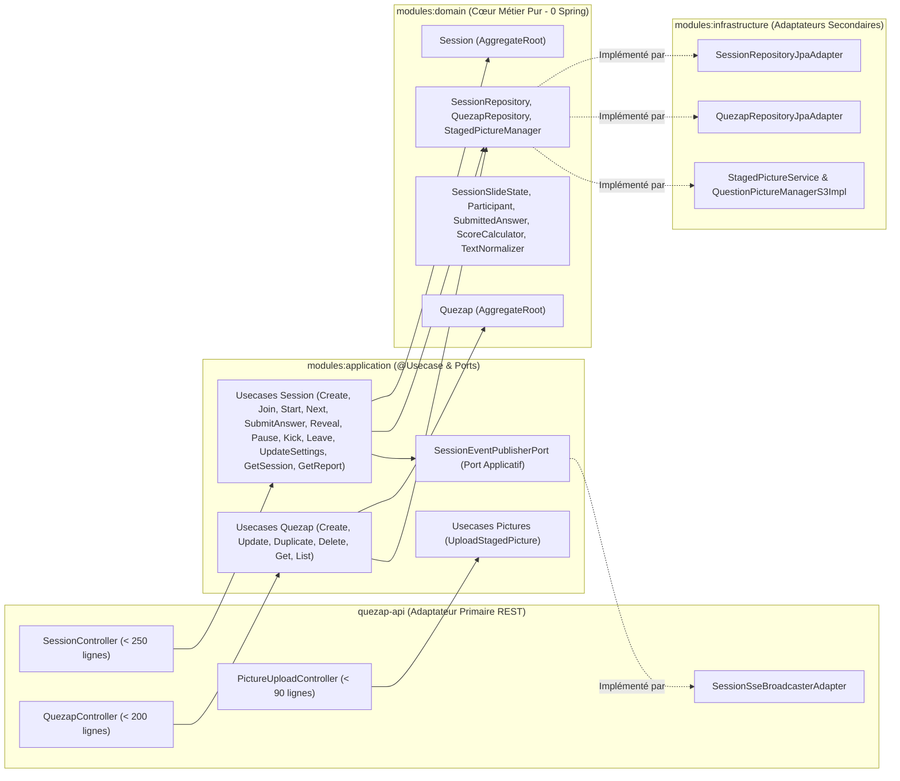

# Spécification Formelle d'Architecture & Sécurité Backend — QueZap (`back/`)

**Feature Branch** : `goal/production-ready` (`specs/003-production-readiness/`)  
**Auteur** : `spec-architect` (Architecte Backend & Sécurité — Conseil de Décision)  
**Date** : 18 Novembre 2026  
**Statut** : Prêt pour arbitrage et exécution par lots

---

## 1. Synthèse de l'État Réel du Backend & Vérifications Qualité

### 1.1 Résultat des Vérifications Outillées Actuelles
L'exécution de la suite de contrôle qualité sur l'état actuel du dépôt (incluant le WIP non commité) donne les résultats suivants :
- **Tests unitaires & intégration (`test -Pnullaway=true`)** : **288 tests exécutés, 0 échec, 0 ignoré** répartis sur 54 classes de test :
  - `:quezap-api` : 10 fichiers (80 tests)
  - `:modules:infrastructure` : 15 fichiers (63 tests)
  - `:modules:domain` : 21 fichiers (93 tests)
  - `:modules:application` : 5 fichiers (25 tests)
  - `:modules:shared` : 3 fichiers (27 tests)
  - `:quezap-cli` : **0 test** (`NO-SOURCE`)
- **NullAway (`-Pnullaway=true` avec `-Werror`)** : **0 erreur** de compilation, mais NullAway est **désactivé par défaut** (`CheckSeverity.OFF`) lorsque le flag `-Pnullaway=true` n'est pas passé explicitement (`back/build.gradle:70-87`).
- **Spotless (`./back/gradlew -p back spotlessCheck`)** : **ÉCHEC (`BUILD FAILED`)** à cause d'une violation de formatage dans le fichier WIP non commité `back/quezap-api/src/test/java/com/quezap/api/v1/routes/pictures/PictureUploadControllerTest.java` (lignes 120-126).
- **Checkstyle (`checkstyleMain` / `checkstyleTest`)** : `BUILD SUCCESSFUL` mais émet **9 avertissements `[LineLength]` (> 100 caractères)** non bloquants dans :
  - `UpdateQuezapRequest.java:12` (127 car.)
  - `CreateQuezapRequest.java:11` (127 car.)
  - `QuezapSlideRequest.java:12-13` (139 et 146 car.)
  - `CreateSessionRequest.java:10` (136 car.)
  - `JoinSessionRequest.java:10-11` (156 et 259 car.)
  - `RawIdentifierTest.java:12` (265 car.)
  - `QuezapControllerTest.java:260` (113 car.)
  - `PictureUploadControllerTest.java:123` (106 car.)

### 1.2 Diagnostic Architectural Global
Le backend souffre d'une **schizophrénie architecturale** entre deux générations de code :
1. **Le socle DDD hexagonal d'origine** (`modules:domain`, `modules:application`, `modules:infrastructure`, `modules:shared`) : très proprement découpé pour `Theme`, `User` et la banque de `Question` isolées, mais dont l'agrégat `Session` et ses 6 handlers applicatifs (`AddSessionHandler`, `StartSessionHandler`, `ParticipateSessionHandler`, `AnswerQuestionHandler`, `AddQuestionToSessionHandler`, `RemoveQuestionFromSessionHandler`) sont du **code mort jamais branché sur l'API REST**.
2. **La couche `quezap-api` récente** (`SessionController` de 1 673 lignes, `QuezapController` de 837 lignes, `AuthController` de 199 lignes, `PictureUploadController` de 98 lignes, `SessionReportService` de 284 lignes) : écrite en **Transaction Script** directement couplée aux entités et repositories Spring Data JPA (`SessionJpaEntity`, `QuezapJpaEntity`, `QuestionJpaEntity`, `StagedPictureJpaEntity`, `UserJpaRepository`), en violation directe de `AGENTS.md`.

---

## 2. Audit Approfondi du WIP Non Commité (Images Stagées & Upload S3)

Périmètre audité : `StagedPictureService.java`, `StagedPictureJpaEntity.java`, `StagedPictureJpaRepository.java`, `PictureUploadController.java`, `PictureUploadResponseDto.java`, `QuestionPictureManager.java`, `QuestionPictureManagerS3Impl.java`, `QuezapController.java`, `QuezapApiRuntimeHints.java`, `docker-compose.yml`, `front/nginx.conf`.

### WIP-01 — Rupture de l'Architecture Hexagonale sur les Images Stagées
- **Sévérité** : Haute
- **Localisation** :
  - `back/quezap-api/src/main/java/com/quezap/api/v1/routes/pictures/PictureUploadController.java:20-45,67-69`
  - `back/quezap-api/src/main/java/com/quezap/api/v1/routes/quezaps/QuezapController.java:55,73,161-163,414-416`
  - `back/modules/infrastructure/src/main/java/com/quezap/infrastructure/adapter/services/StagedPictureService.java:22-110`
- **Constat** :
  - `StagedPictureService` est placé dans `modules:infrastructure` et manipule directement `StagedPictureJpaRepository` et `StagedPictureJpaEntity`.
  - `PictureUploadController` et `QuezapController` (dans `quezap-api`) importent directement `StagedPictureService` et `UserJpaRepository` depuis `modules:infrastructure`, court-circuitant totalement `modules:domain` et `modules:application`.
  - `PictureUploadController.java:61` appelle une méthode statique d'un autre contrôleur REST (`QuezapController.toPublicPictureUrl(...)`) pour construire l'URL publique S3.
- **Correction exigée** :
  - Définir un port domaine `StagedPictureManager` (ou enrichir `QuestionPictureManager`) dans `modules:domain/src/main/java/com/quezap/domain/ports/services/` avec les opérations métier (`stagePicture`, `claimPictures`, `purgeExpiredPictures`, `toPublicUrl`, `toObjectKey`).
  - L'implémentation `StagedPictureService` dans `modules:infrastructure` implémente ce port sans jamais exposer `StagedPictureJpaEntity` hors d'`infrastructure`.

### WIP-02 — Destruction d'Images S3 Partagées lors du `clone` / `duplicate` puis `update` / `delete`
- **Sévérité** : **Critique (Perte de données S3)**
- **Localisation** :
  - `back/quezap-api/src/main/java/com/quezap/api/v1/routes/quezaps/QuezapController.java:168-214,418-419,432-434,717-728,739-815`
- **Constat** :
  - `QuezapController.duplicate()` (l.171) et `QuezapController.clone()` (l.742) appellent `cloneQuestion(QuestionJpaEntity source)` (l.786-815).
  - `cloneQuestion` crée une nouvelle `QuestionJpaEntity` et de nouvelles `AnswerJpaEntity` en **recopiant à l'identique la chaîne `source.getPictureFilename()` et `ans.getPictureFilename()`** sans dupliquer l'objet S3 (`questionPictureManager.copy(...)` n'est jamais appelé).
  - Or, le WIP a ajouté dans `update()` (l.418-419), `delete()` (l.434) et `removeQuestion()` (l.727) l'appel `removePicturesFromStorage(removedUrls)` qui exécute `questionPictureManager.removeByObjectKey(key)` dès qu'une URL disparaît du Quezap modifié ou supprimé !
  - **Scénario de perte de données** : L'enseignant A crée un quiz public avec une image `X.png`. L'enseignant B (ou A lui-même) duplique ce quiz, puis supprime la copie (ou remplace l'image dans la copie) : `removePicturesFromStorage` supprime `X.png` dans MinIO/S3, **cassant définitivement l'image du quiz original** !
  - De plus, `POST /apiv1/quezaps/{id}/duplicate` (l.168, `isPublic=false`) et `POST /apiv1/quezaps/{id}/clone` (l.739, `isPublic=original.getIsPublic()`) sont deux routes quasi-dupliquées dans le même contrôleur.
- **Correction exigée** :
  - **Etape 1 (Référence counting en BDD)** : Avant de supprimer un `objectKey` de S3 dans `removePicturesFromStorage`, vérifier en base (`questionJpaRepository.existsByPictureFilename(url)` et `answerJpaRepository.existsByPictureFilename(url)`) qu'aucune autre question ni réponse ne référence encore cette URL/clé.
  - **Etape 2 (Ou copie S3)** : Lors du clonage, soit conserver le partage avec vérification de référence avant suppression S3 (plus économe en stockage et instantané), soit copier l'objet S3. La vérification de référence (`countReferences(pictureUrl) == 0`) est **obligatoire** dans tous les cas pour empêcher toute suppression d'image encore référencée.

### WIP-03 — Contournement d'Autorisation (`claimPictures`) & Traversée de Clé S3 (`toObjectKey` / `toPublicPictureUrl`)
- **Sévérité** : Haute (Sécurité)
- **Localisation** :
  - `back/modules/infrastructure/src/main/java/com/quezap/infrastructure/adapter/services/StagedPictureService.java:58-72`
  - `back/modules/infrastructure/src/main/java/com/quezap/infrastructure/adapter/persistence/jpa/repositories/StagedPictureJpaRepository.java:26-28`
  - `back/quezap-api/src/main/java/com/quezap/api/v1/routes/quezaps/QuezapController.java:418-419,612-669`
- **Constat** :
  1. **Vol / Claim inter-utilisateurs** : `StagedPictureJpaEntity` enregistre `uploaderId` (`uploader_id`), mais `StagedPictureService.claimPictures(Collection<String> pictureUrls)` exécute `DELETE FROM StagedPictureJpaEntity sp WHERE sp.pictureUrl IN :pictureUrls` **sans vérifier `uploaderId`**. Un utilisateur A peut référencer l'URL stagée d'un utilisateur B ou empêcher son nettoyage. Plus grave : si un utilisateur malveillant soumet dans `update()` une `pictureFilename` pointant vers l'image d'un autre quiz, puis la retire au prochain `update()`, `previousUrls - currentUrls` déclenche `removePicturesFromStorage` et **supprime du bucket S3 l'image appartenant à un autre enseignant** !
  2. **Validation laxiste des URLs et Path Traversal dans `toObjectKey` / `toPublicPictureUrl`** :
     - `toPublicPictureUrl` (l.656-660) accepte telle quelle toute chaîne commençant par `http://`, `https://` ou `/` (ex. `https://evil.tracker/pixel.png` ou `/apiv1/auth/logout` stocké en base comme URL d'image et chargé en `` par tous les élèves et le projecteur -> SSRF client / tracking / CSRF GET).
     - `toObjectKey` (l.612-633) ne rejette pas les séquences `..` ni les clés hors du format strict `pictures/questions/<uuid>.<ext>`.
- **Correction exigée** :
  - Restreindre `resolvePictureFilename` / `toPublicPictureUrl` aux seules clés/URLs internes correspondant au motif strict `^(/quezap-public-images/)?pictures/questions/[0-9a-fA-F-]{36}\.(jpg|jpeg|png|webp)$`. Rejeter par `400 Bad Request` toute URL externe (`http://`, `https://`), tout `..`, ou tout chemin hors `pictures/questions/`.
  - Vérifier dans `claimPictures(Collection<String> pictureUrls, UUID uploaderId)` que chaque image nouvellement attachée est soit déjà présente sur la question existante du quiz, soit stagée par `uploaderId` (sinon `403 Forbidden` / `400 Bad Request`).

### WIP-04 — Bug Transactionnel & Tolérance aux Pannes S3 dans `purgeExpiredPictures` et `upload`
- **Sévérité** : Haute
- **Localisation** :
  - `back/modules/infrastructure/src/main/java/com/quezap/infrastructure/adapter/services/StagedPictureService.java:74-97`
  - `back/quezap-api/src/main/java/com/quezap/api/v1/routes/pictures/PictureUploadController.java:58-71`
- **Constat** :
  1. **Perte de suivi des fichiers S3 non supprimés (`StagedPictureService.java:85-94`)** :
     Dans `purgeExpiredPictures()`, la boucle tente `questionPictureManager.removeByObjectKey(picture.getObjectKey())`. Si S3/MinIO est temporairement indisponible ou renvoie une erreur 5xx, l'exception est catchée et loggée en `warn` (l.89-91), mais la ligne 94 exécute **`stagedPictureJpaRepository.deleteAllInBatch(expired)` sur TOUTE la liste `expired`**, y compris les entrées dont la suppression S3 a échoué ! Ces fichiers deviennent alors des **orphelins permanents dans S3** qui ne seront plus jamais retentés.
  2. **Fichier S3 orphelin si la base échoue à l'upload (`PictureUploadController.java:60-70`)** :
     `questionPictureManager.store(uploadData)` écrit d'abord dans S3, puis `stagedPictureService.registerStagedPicture(...)` écrit en base. Si l'insertion BDD échoue, l'objet S3 fraîchement uploadé n'est pas nettoyé en bloc `catch`.
  3. **Suppression S3 avant commit BDD dans `QuezapController.update` / `delete` (`QuezapController.java:410-419,433-434`)** :
     `QuezapController` est annoté `@Transactional`. `removePicturesFromStorage` supprime immédiatement les fichiers sur S3 **avant** que la transaction JPA ne soit commitée (et si `delete(quezap)` échoue au commit/flush par contrainte de clé étrangère avec une `SessionJpaEntity`, les images S3 ont déjà été détruites alors que le Quezap existe toujours en base !).
- **Correction exigée** :
  - Dans `purgeExpiredPictures()`, collecter une liste `successfullyDeletedFromS3` et n'appeler `stagedPictureJpaRepository.deleteAllInBatch(successfullyDeletedFromS3)` que sur les entités effectivement supprimées de S3 (ou absentes 404).
  - Dans `PictureUploadController.upload()`, si `registerStagedPicture` lève une exception après `store()`, appeler `questionPictureManager.removeByObjectKey(stored.objectKey())` en compensation avant de relancer l'erreur.
  - Différer `removePicturesFromStorage` après le commit effectif de la transaction via `TransactionSynchronizationManager.registerSynchronization(new TransactionSynchronization() { afterCommit() ... })` ou via `UnitOfWorkEvents.onCommit(...)`.

### WIP-05 — Risque de Deadlock `PipedInputStream` dans `QuestionPictureManagerS3Impl.store` & Validation Image
- **Sévérité** : Moyenne
- **Localisation** :
  - `back/modules/infrastructure/src/main/java/com/quezap/infrastructure/adapter/services/QuestionPictureManagerS3Impl.java:49-85,175-204`
  - `back/modules/application/src/main/java/com/quezap/lib/utils/FileVerifyingHelper.java:26-46,86-147`
- **Constat** :
  - `QuestionPictureManagerS3Impl.store` utilise un couple `PipedOutputStream` / `PipedInputStream` (buffer par défaut de 1 024 octets seulement !) alimenté par un thread `pictureHashingExecutor`. Si `s3Client.putObject` échoue immédiatement (ex. connexion MinIO refusée avant lecture complète du flux), le `try-with-resources` tente de fermer `pipedInputStream` puis sort, mais si on attendait `hashFuture.get()` ou si le pool `pictureHashingExecutor` est saturé par des uploads concurrents, le thread producteur reste bloqué sur `outputStream.write(...)`. De plus, pour un fichier limité à 5 Mo (`spring.servlet.multipart.max-file-size: 5MB`), calculer le SHA-256 directement ou utiliser un `DigestInputStream` sur le flux lu par S3 évite totalement le thread supplémentaire et le `PipedInputStream` !
  - `FileVerifyingHelper.fileNameIsValidAndMatchesExtension` (l.40-45) exige `detectedMimeType.equalsIgnoreCase(expectedMimeType)` mais **ne vérifie jamais que l'extension du fichier (`.png`, `.jpg`, `.webp`) correspond au `detectedMimeType`** (la variable `fileExtension` extraite ligne 34 n'est jamais comparée au type MIME !), et `detectEncoding` (l.135) passe le *nom du fichier* (quelques octets) à `CharsetDetector` de Tika, ce qui produit des faux positifs d'encodage sur les noms de fichiers accentués courts.
- **Correction exigée** :
  - Remplacer le couple `PipedInputStream`/`PipedOutputStream` + thread séparé dans `QuestionPictureManagerS3Impl.store` par un `DigestInputStream(new BufferedInputStream(uploadData.inputStream()), MessageDigest.getInstance("SHA-256"))` lu directement en une passe par `RequestBody.fromInputStream(digestStream, contentLength)`. Plus aucun risque de deadlock ni besoin de pool de threads dédié.
  - Dans `FileVerifyingHelper`, supprimer `detectEncoding` sur le nom de fichier (les noms Multipart sont déjà des `String` Java UTF-16) et vérifier que `PictureType.fromMimeType(detectedMimeType).extensions()` contient bien `fileExtension.toLowerCase(Locale.ROOT)`.

### WIP-06 — `nginx.conf` (`client_max_body_size 100M`) Disproportionné et Commentaire Obsolète
- **Sévérité** : Basse / Configuration
- **Localisation** :
  - `front/nginx.conf:5-6`
  - `back/quezap-api/src/main/resources/application.yml:10-12`
- **Constat** :
  - `front/nginx.conf` configure `client_max_body_size 100M;` avec le commentaire `# Allow large payloads (e.g. quiz saves with multiple embedded base64 images)`, alors que le WIP interdit désormais explicitement le base64 dans `QuezapController.resolvePictureFilename` (l.587-591) et que Spring Boot limite les requêtes multipart à `max-file-size: 5MB` / `max-request-size: 10MB`. Autoriser 100 Mo au niveau Nginx expose inutilement le reverse-proxy à du buffering disque/mémoire massif.
- **Correction exigée** :
  - Aligner `client_max_body_size 15M;` dans `front/nginx.conf` avec la limite Spring Boot (`10MB`) et mettre à jour le commentaire.

---

## 3. Plan Exact de Découpage Hexagonal de `SessionController` (1 673 lignes) & `QuezapController` (837 lignes)

### 3.1 Diagnostic des Bugs Métier & Concurrence dans `SessionController`

Au-delà de sa taille (1 673 lignes) et de son couplage direct aux entités JPA (`SessionJpaEntity`, `SessionParticipantJpaEntity`, `SessionAnswerJpaEntity`, `QuezapJpaEntity`), l'audit ligne à ligne de `SessionController` révèle **7 défauts techniques et fonctionnels majeurs** :

1. **SC-BUG-01 — État de pause en mémoire volatile (`pausedAtBySessionId`) perdu au redémarrage** (`SessionController.java:101,726,881-890,1189`) :
   - La date de mise en pause est stockée dans une `ConcurrentMap<UUID, Instant> pausedAtBySessionId` en mémoire du contrôleur au lieu d'une colonne `paused_at` sur `SessionJpaEntity` / `Session`.
   - Si le serveur redémarre pendant une pause, `pausedAtBySessionId.get(id)` renvoie `null` : lors de la reprise (`pauseSession(false)`), le décalage `pausedDuration` n'est pas ajouté à `currentSlideStartedAt`, ce qui fait expirer instantanément le chrono de la question en cours !
2. **SC-BUG-02 — Soumission de réponse autorisée pendant que la session est en pause (`isPaused = true`)** (`SessionController.java:647-847`) :
   - `submitAnswer` vérifie `startedAt != null`, `endedAt == null`, `lastRevealedSlideIndex < effectiveSlideIndex` et le timer (en figant `effectiveNow = pausedAt`), mais **ne rejette pas les réponses soumises pendant une pause** (`Boolean.TRUE.equals(sessionJpa.getIsPaused())`). Un élève peut donc répondre pendant la pause explications du professeur avec un chrono figé (`effectiveNow = pausedAt`), obtenant le même score maximal que s'il avait répondu à l'instant où la pause a commencé !
3. **SC-BUG-03 — Race condition sur le score du participant et perte de mises à jour concurrentes** (`SessionController.java:653,796-822`) :
   - `submitAnswer` charge `SessionJpaEntity` avec ses collections lazy `participants` et `answers`, calcule `participant.setScore(participant.getScore() + pointsAwarded)`, et appelle `sessionDataPort.saveSession(sessionJpa)` sans verrouillage (`@Version` absent de `SessionJpaEntity` et `SessionParticipantJpaEntity`).
   - En outre, charger toute la collection `sessionJpa.getAnswers()` (qui grossit de $N$ lignes à chaque question, soit $60 \times 100 = 6\,000$ entités en fin de session) à chaque vote de chaque élève génère une complexité mémoire et SQL quadratique $O(Q \times P^2)$ sur l'ensemble de la session.
4. **SC-BUG-04 — Absence de départage des ex-æquo au score par temps de réponse (`specs/001` Edge Case)** (`SessionController.java:1314,1474`, `SessionReportService.java:53,95,123`) :
   - Le tri du classement utilise uniquement `Comparator.comparing(SessionParticipantJpaEntity::getScore).reversed()`. En cas d'égalité de points (ex. 2 élèves à 1000 pts), l'ordre dépend de l'ordre du `Set` Hibernate (non déterministe entre deux appels !).
5. **SC-BUG-05 — Fuite de toutes les sessions à un appelant non authentifié ou non-UUID dans `list()`** (`SessionController.java:129-144`) :
   - Dans `GET /apiv1/sessions`, si `authorId == null` et que le principal n'est pas un UUID valide (ex. `"anonymousUser"` si la route était mal protégée ou en test), le bloc `catch (IllegalArgumentException _)` exécute `sessionDataPort.findAllSessions(pageRequest)`, retournant les sessions de tous les enseignants. Et même avec un `authorId` fourni en query param (`?authorId=UUID_AUTRE_PROF`), `SessionController.list` ne vérifie pas que `authorId` correspond à l'enseignant connecté !
6. **SC-BUG-06 — `getScores()` (`GET /apiv1/sessions/{id}/scores`) renvoie un `delta` égal au score total et `streak = 1` en dur** (`SessionReportService.java:102`) :
   - `new LeaderboardEntryDto(rank++, p.getName(), p.getScore(), p.getScore(), 1)` : `delta` reçoit `p.getScore()` au lieu du delta du tour et `streak` vaut `1` en dur.
7. **SC-BUG-07 — Suppression d'un Quezap référencé par une Session provoque une erreur 500 SQL (`DataIntegrityViolationException`)** (`SessionJpaEntity.java:46-47`, `QuezapController.java:422-435`) :
   - `SessionJpaEntity` possède une clé étrangère `quezap_id` vers `QuezapJpaEntity`. Quand un enseignant tente de supprimer un Quezap ayant déjà servi à une session (`DELETE /apiv1/quezaps/{id}`), PostgreSQL rejette le `DELETE` par violation de contrainte FK (500 Internal Server Error), et pire, `removePicturesFromStorage` était appelé dans la foulée.

### 3.2 Architecture Hexagonale Cible pour le Domaine `Session` et `Quezap`

Conformément à `AGENTS.md`, la règle d'or est :
> **`quezap-api` ne doit contenir AUCUN import de `com.quezap.infrastructure.adapter.persistence.jpa.**`**.

#### A. Couche `modules:domain` (Enrichissement du modèle métier pur)
1. **Aligner l'agrégat `Session` (`com.quezap.domain.models.entities.Session`) sur la réalité fonctionnelle** :
   - Remplacer l'invariant `hasEnoughParticipantsToStart() { return participants.size() >= 2; }` (`Session.java:366`) par `>= 0` (ou `>= 1` configurable), car un enseignant en classe ou en démonstration lance légitimement la session dès le lobby (le contrôleur actuel autorise le démarrage à 0 ou 1 participant, ce qui expliquait pourquoi `Session.startSession()` avait été contourné !).
   - Ajouter à `Session` les états temporels de slide : `currentSlideStartedAt` (`@Nullable TimelinePoint`), `pausedAt` (`@Nullable TimelinePoint`), `lastRevealedSlideIndex` (`@Nullable Integer`), et l'identifiant du quiz `quezapId` (`@Nullable QuezapId`).
   - Encapsuler dans `Session` les transitions métier et leurs invariants :
     - `start(TimelinePoint now)` : passe `currentSlideIndex` à `1`, `startedAt = now`, `currentSlideStartedAt = now`, `isPaused = false`.
     - `advanceToNextSlide(TimelinePoint now)` : incrémente `currentSlideIndex` ou termine la session (`end(now)`) si `currentSlideIndex + 1 > totalSlides`, réinitialise `isPaused = false` et `pausedAt = null`.
     - `pause(TimelinePoint now)` / `resume(TimelinePoint now)` : stocke `pausedAt = now` à la pause ; à la reprise, décale `currentSlideStartedAt` de `Duration.between(pausedAt, now)` et remet `pausedAt = null`.
     - `revealCurrentSlide()` : verrouille `lastRevealedSlideIndex = currentSlideIndex`.
     - `submitAnswer(...)` : vérifie que la session est active, **non en pause (`!isPaused`)**, que la slide courante n'est pas déjà révélée (`lastRevealedSlideIndex == null || lastRevealedSlideIndex < currentSlideIndex`), que le délai `timerSeconds + 2s` n'est pas dépassé, évalue la réponse (`QUIZZ`, `BOOLEAN`/`AFFIRMATION`, `CASH` via `TextNormalizer`), calcule le score via `Session.calculateScore(...)`, et met à jour la réponse et le score du participant.
     - `kickParticipant(ParticipantName name)` et `leaveParticipant(ParticipationToken token)`.
2. **Ports Domaine (`com.quezap.domain.ports.**`)** :
   - `StagedPictureManager` : gestion du cycle de vie des images uploadées/stagées, validation du format d'URL publique, comptage des références avant suppression S3.

#### B. Couche `modules:application` (Usecases `@Usecase` & Port d'Événements Temps Réel)
1. **Définir un port applicatif `SessionRealtimePublisher`** dans `com.quezap.application.ports.sessions` :
   - Permet aux handlers `@Usecase` d'ordonner la diffusion des événements SSE (`publishLobbyState`, `publishSessionStarted`, `publishQuestionStart`, `publishAnswerCount`, `publishQuestionReveal`, `publishIntermediateLeaderboard`, `publishPauseStatus`, `publishParticipantKicked`, `publishSessionEnded`) via `unitOfWork.onCommit(...)` (garantissant qu'aucun événement SSE n'est diffusé avant la validation de la transaction BDD !).
2. **Découper `SessionController` en 12 Usecases / Services Applicatifs cohésifs** dans `com.quezap.application.usecases.sessions` :
   - `CreateSessionHandler` (`POST /apiv1/sessions`)
   - `JoinSessionHandler` (`POST /apiv1/sessions/join`)
   - `StartSessionLifecycleHandler` (`POST /apiv1/sessions/{id}/start`)
   - `NextSessionQuestionHandler` (`POST /apiv1/sessions/{id}/next-question`)
   - `SubmitSessionAnswerHandler` (`POST /apiv1/sessions/{id}/answers`)
   - `RevealSessionQuestionHandler` (`POST /apiv1/sessions/{id}/reveal`)
   - `ToggleSessionPauseHandler` (`POST /apiv1/sessions/{id}/pause`)
   - `UpdateSessionSettingsHandler` (`PUT /apiv1/sessions/{id}/settings`)
   - `KickSessionParticipantHandler` (`POST /apiv1/sessions/{id}/participants/{name}/kick`)
   - `LeaveSessionHandler` (`POST /apiv1/sessions/{id}/leave`)
   - `SessionQueryService` (lectures : `getById`, `getByCode`, `list`, `getInitialStreamData`)
   - `SessionReportApplicationService` (génération du rapport `buildSessionReport`, `buildScores`, `exportCsv`)
3. **Supprimer `SessionDataPort` et `SessionDataJpaAdapter` de `quezap-api`** : les déplacer et les typer proprement dans `modules:application` / `modules:infrastructure`.
4. **Extraire la logique de `QuezapController` vers un service applicatif `QuezapApplicationService` (ou Usecases dédiés)** dans `modules:application` afin que `QuezapController` ne manipule plus directement `QuezapJpaRepository`, `QuestionJpaRepository`, `ThemeJpaRepository` et `UserJpaRepository`.

---

## 4. Consolidation de l'Audit Sécurité, Périphérie, SSE, CLI & GraalVM 25

L'audit complet des composants périphériques (détaillé avec preuves ligne par ligne dans [notes-backend-periphery.md](file:///home/jeremy/projets/QueZap/specs/003-production-readiness/notes-backend-periphery.md)) met en évidence **13 chantiers de sécurisation et de fiabilisation (`P-01` à `P-13`)** résumés ci-dessous :

| ID | Sévérité | Composant | Synthèse du Problème & Correction Requise |
| :--- | :---: | :--- | :--- |
| **P-01** | 🔴 Critique | `UserController` & `UpdateUserPasswordHandler` | **IDOR & bypass `oldPassword`** : tout utilisateur authentifié peut lister tous les comptes, modifier le mot de passe d'un autre utilisateur (sans vérification de `oldPassword`, ignoré l.120) ou supprimer un autre compte. **Fix** : vérifier `currentUserId.equals(id)` (ou `ROLE_ADMIN`) et vérifier `passwordHasher.verify(oldPassword, ...)` dans le handler. |
| **P-02** | 🔴 Critique | `application*.yml` & `JwtServiceConfig` | **Secrets par défaut en clair en `prod`** (`APP_JWT_SECRET_KEY`, `LocalPassword`, `quezap_password`) et `ddl-auto: update` actif en prod. **Fix** : supprimer les fallbacks de secrets en profil `prod`, valider au démarrage que la clé JWT fait ≥ 32 octets et n'est pas la clé de dev en profil `prod`, passer `ddl-auto: validate` en `prod` (ou garder `update` uniquement en `dev`/`local`). |
| **P-03** | 🟠 Haute | `ThemeController`, `DeleteQuestionController` | **Absence de contrôle d'accès sur les mutations de thèmes/questions** : n'importe quel compte authentifié peut supprimer/renommer un thème ou supprimer une question utilisée par un autre quiz. **Fix** : interdire la suppression d'un thème ou d'une question référencée par le Quezap d'un autre auteur (`409 Conflict` / `403 Forbidden`). |
| **P-04** | 🟠 Haute | `SecurityConfig.java:60-76` | **Sur-exposition `permitAll()`** : `GET /apiv1/questions/**` (fuite de la banque de questions), `/actuator/**` (tous les endpoints Actuator) et `GET /apiv1/sessions/*` (accès anonyme par UUID aux détails d'une session). **Fix** : retirer `/apiv1/questions/**` de `permitAll()`, limiter Actuator public à `/actuator/health/**`. |
| **P-05** | 🟠 Haute | `SecurityConfig.java:83-94` | **CORS wildcard `*` avec `allowCredentials(true)`**. **Fix** : rendre les origines CORS configurables via `${APP_CORS_ALLOWED_ORIGINS:http://localhost:4200,http://localhost:8000}` et restreindre les en-têtes exposés. |
| **P-06** | 🟠 Haute | `AuthController.java:133-198` | **Validation JWT `refresh` laxiste** (`tokenType != null && !"refresh".equals(tokenType)` accepte un token sans claim `type`), pas de révocation au `logout`, endpoints stubs (`forgotten-password`, `reset-password`, `activate`) et absence de rate-limiting sur `/login`. **Fix** : exiger `"refresh".equals(tokenType)`, implémenter une révocation des refresh tokens (ou blacklist en mémoire/BDD), ajouter une protection anti-bruteforce par IP/identifiant sur `/login`. |
| **P-07** | 🟠 Haute | `AuthController`, `UserController`, `CreateUserRequest` | **Couplage direct à `UserJpaRepository`** dans `AuthController` et génération silencieuse d'un mot de passe aléatoire jeté dans `CreateUserRequest` si `password` est vide. **Fix** : passer par un port applicatif et exiger un mot de passe non vide sur l'inscription HTTP. |
| **P-08** | 🟠 Haute | `GlobalExceptionHandler.java:32-84` | **Mapping 404 cassé** (cherche `"not found"` mais les erreurs thèmes/questions disent `"does not exist"` -> renvoie `400` au lieu de `404`), `IllegalDomainStateException` et `DataIntegrityViolationException` non gérées (renvoient `500`), pas de fallback `Exception.class`. **Fix** : mapper explicitement les codes `NOT_FOUND` / `"does not exist"` en `404`, gérer `IllegalDomainStateException` (`400`/`409`) et `DataIntegrityViolationException` (`409`), ajouter un fallback `500` propre. |
| **P-09** | 🟠 Haute | `SessionSseService.java:31-104` | **Fuite mémoire & concurrence SSE** : `sessionSequences` et `eventHistory` ne sont jamais purgés ; l'ajout et le trim à `MAX_HISTORY_SIZE` sur `CopyOnWriteArrayList` ne sont pas atomiques ; les emitters en erreur dans `sendToEmitter` ne sont pas fermés/retirés ; `@EnableScheduling` posé sur un `@Service`. **Fix** : synchroniser l'historique par `sessionId`, ajouter une purge TTL des sessions inactives/terminées, fermer proprement les emitters morts, déplacer `@EnableScheduling` sur une `@Configuration`. |
| **P-10** | 🟡 Moyenne | `SessionReportService.java:28-90` | **Export CSV sans BOM UTF-8 ni `charset=UTF-8`**, contournement de `escapeCsvCell` via `\n=CMD()`, et re-filtrage $O(P \times A)$ des réponses. **Fix** : ajouter `\uFEFF`, `MediaType("text", "csv", UTF_8)`, neutraliser les retours à la ligne / formules multilignes dans `escapeCsvCell`, pré-indexer les réponses par participant et par slide. |
| **P-11** | 🟡 Moyenne | `PaginationValidator`, `AddQuestionDto`, `AuthController.me` | **Tautologie `PaginationValidator.isValid`** (retourne toujours `true`), `@Nonnull` au lieu de `@NotNull`, `UUID.fromString` non protégé dans `/me`. **Fix** : corriger l'expression booléenne de `PaginationValidator`, utiliser `@NotNull`/`@NotBlank`, gérer `IllegalArgumentException` -> `401` dans `/me`. |
| **P-12** | 🟡 Moyenne | `quezap-cli` (`UserCommands`, `SeedCommands`) | **Mot de passe affiché en clair** (`readLine(prompt, null)`), `SeedCommands` actif sans restriction de profil, boucle `listUsers` incorrecte, mot de passe DB par défaut divergent (`quezap` vs `quezap_password`). **Fix** : masquer avec `'*'`, protéger le seeding hors `prod`, corriger `hasNextPage()`, aligner `application.yml`. |
| **P-13** | 🟡 Moyenne | `QuezapApiRuntimeHints`, `build.gradle` | **`ValidationRuntimeHints` mort** dans `ApiApplication`, DTOs hors `sessions` absents de `QuezapApiRuntimeHints`, `NullAway` désactivé par défaut sans `-Pnullaway=true`, `spotlessJavaCheck` en échec sur le WIP. **Fix** : activer NullAway par défaut dans `build.gradle`, nettoyer `ValidationRuntimeHints`, enregistrer tous les DTOs REST dans `QuezapApiRuntimeHints`, appliquer Spotless et supprimer les 9 warnings Checkstyle. |

---

## 5. Critères d'Acceptation Testables (Definition of Done Backend)

Chaque lot d'implémentation devra satisfaire l'intégralité des critères vérifiables suivants :

1. **CA-QUAL-01 (Qualité & Build Zéro Défaut)** :
   - `./back/gradlew -p back spotlessCheck checkstyleMain checkstyleTest test -Pnullaway=true` s'exécute avec **0 erreur, 0 échec de test et 0 warning Checkstyle (`[LineLength]` = 0)**.
   - NullAway est activé par défaut dans `back/build.gradle` (sauf désactivation explicite `-Pnullaway=false`).
2. **CA-ARCH-01 (Étanchéité Hexagonale)** :
   - Aucune classe de `quezap-api/src/main/java/com/quezap/api/v1/routes/**` n'importe `com.quezap.infrastructure.adapter.persistence.jpa.repositories.*` ni `com.quezap.infrastructure.adapter.persistence.jpa.entities.*`.
   - `SessionController` fait moins de 300 lignes et délègue toute la logique métier aux Usecases / Services de `modules:application`.
3. **CA-PIC-01 (Sécurité & Intégrité du WIP Images Stagées)** :
   - `POST /apiv1/pictures/upload` rejette tout fichier dont l'extension ne correspond pas au type MIME réel détecté par Tika (`image/jpeg`, `image/png`, `image/webp`) et nettoie S3 si l'enregistrement BDD échoue.
   - `QuezapController` (via le service applicatif) rejette par `400 Bad Request` toute `pictureFilename` contenant `http://`, `https://`, `data:`, `..`, ou ne respectant pas le préfixe `/quezap-public-images/pictures/questions/`.
   - Dupliquer/cloner un Quezap contenant une image, puis supprimer ou modifier le Quezap dupliqué **ne supprime pas** l'objet S3 tant que le Quezap original (ou toute autre question/réponse) référence encore cette image (test unitaire + intégration dédié).
   - `StagedPictureService.purgeExpiredPictures()` ne supprime en base de données que les entrées dont la suppression S3 a effectivement réussi (en cas d'erreur S3 sur une image, son entrée BDD est conservée pour le prochain cycle `@Scheduled`).
4. **CA-SESS-01 (Intégrité Temps Réel & Anti-Triche des Sessions)** :
   - Soumettre une réponse (`POST /apiv1/sessions/{id}/answers`) alors que la session est en pause (`isPaused == true`), ou après révélation (`409 Conflict`), ou après expiration du délai (`400 Bad Request`), est systématiquement rejeté.
   - L'instant de mise en pause (`pausedAt`) est persisté en base sur `SessionJpaEntity` : une pause suivie d'une reprise décale exactement `currentSlideStartedAt` de la durée de pause sans reposer sur une Map en mémoire volatile.
   - Les égalités de score dans le classement intermédiaire, le podium final et le rapport/CSV sont départagées de manière déterministe (par temps de réponse cumulé ou ordre d'arrivée, jamais par l'ordre aléatoire d'un `HashSet`).
   - La suppression d'un Quezap ayant des sessions rattachées détache proprement `session.quezap = null` (ou retourne un `409 Conflict` explicite) au lieu d'échouer en `500 DataIntegrityViolationException`.
5. **CA-SEC-01 (Contrôle d'Accès, Auth & Erreurs HTTP)** :
   - `UserController` rejette par `403 Forbidden` toute lecture/modification/suppression du compte d'un autre utilisateur (`!currentUserId.equals(id)`), et `UpdateUserPasswordHandler` vérifie l'ancien mot de passe (`oldPassword`).
   - `AuthController.refresh` rejette par `401 Unauthorized` tout JWT dont le claim `type` est `null` ou différent de `"refresh"`, ainsi que tout refresh token révoqué via `/apiv1/auth/logout`.
   - `GlobalExceptionHandler` retourne `404 Not Found` pour `RemoveThemeError.THEME_DOES_NOT_EXISTS`, `RenameThemeError.THEME_DOES_NOT_EXISTS`, `AddQuestionError.THEME_DOES_NOT_EXISTS` et `DeleteQuestionError.QUESTION_NOT_FOUND`.
   - `SessionReportService.exportCsv` retourne `Content-Type: text/csv;charset=UTF-8` avec BOM `\uFEFF` et neutralise les formules de tableur y compris après saut de ligne (`\n=`).

---

## 6. Découpage en Lots d'Exécution Sans Collision de Fichiers

Afin de permettre une exécution parallèle par une escouade d'agents sans aucun conflit Git, les travaux backend sont découpés en **4 lots strictement isolés par sous-arborescence de fichiers** :

### Lot B1 — Stabilisation & Architecture du Flux Images Stagées / S3 & Quezaps
- **Propriété exclusive des fichiers** :
  - `back/modules/domain/src/main/java/com/quezap/domain/ports/services/QuestionPictureManager.java`
  - `back/modules/domain/src/main/java/com/quezap/domain/ports/services/StagedPictureManager.java` *(nouveau)*
  - `back/modules/infrastructure/src/main/java/com/quezap/infrastructure/adapter/services/QuestionPictureManagerS3Impl.java`
  - `back/modules/infrastructure/src/main/java/com/quezap/infrastructure/adapter/services/StagedPictureService.java`
  - `back/modules/infrastructure/src/main/java/com/quezap/infrastructure/adapter/persistence/jpa/entities/StagedPictureJpaEntity.java`
  - `back/modules/infrastructure/src/main/java/com/quezap/infrastructure/adapter/persistence/jpa/repositories/StagedPictureJpaRepository.java`
  - `back/modules/infrastructure/src/main/java/com/quezap/infrastructure/adapter/persistence/jpa/repositories/QuestionJpaRepository.java`
  - `back/modules/infrastructure/src/main/java/com/quezap/infrastructure/adapter/persistence/jpa/repositories/QuezapJpaRepository.java`
  - `back/modules/application/src/main/java/com/quezap/lib/utils/FileVerifyingHelper.java`
  - `back/quezap-api/src/main/java/com/quezap/api/v1/routes/pictures/**`
  - `back/quezap-api/src/main/java/com/quezap/api/v1/services/PictureMetadataValidatorService.java`
  - `back/quezap-api/src/main/java/com/quezap/api/v1/routes/quezaps/**`
  - `back/quezap-api/src/main/java/com/quezap/api/v1/dto/request/quezaps/**`
  - `back/modules/infrastructure/src/test/java/com/quezap/infrastructure/adapter/services/StagedPictureServiceTest.java`
  - `back/quezap-api/src/test/java/com/quezap/api/v1/routes/pictures/**`
  - `back/quezap-api/src/test/java/com/quezap/api/v1/routes/QuezapControllerTest.java`
  - `front/nginx.conf`
- **Périmètre** : Résolution de **WIP-01 à WIP-06**, suppression du deadlock potentiel `PipedInputStream` au profit de `DigestInputStream`, comptage des références avant suppression S3 lors du clone/update/delete de Quezap, nettoyage post-commit, validation stricte des URLs d'images et de la correspondance extension/MIME, correction des warnings Checkstyle sur `CreateQuezapRequest`, `UpdateQuezapRequest`, `QuezapSlideRequest`, `QuezapControllerTest`, `PictureUploadControllerTest`.

### Lot B2 — Refactoring Hexagonal Complet de `SessionController`, SSE & Rapports CSV
- **Propriété exclusive des fichiers** :
  - `back/modules/domain/src/main/java/com/quezap/domain/models/entities/Session.java`
  - `back/modules/infrastructure/src/main/java/com/quezap/infrastructure/adapter/persistence/jpa/entities/SessionJpaEntity.java`
  - `back/modules/infrastructure/src/main/java/com/quezap/infrastructure/adapter/persistence/jpa/repositories/SessionJpaRepository.java`
  - `back/modules/application/src/main/java/com/quezap/application/ports/sessions/**`
  - `back/modules/application/src/main/java/com/quezap/application/usecases/sessions/**`
  - `back/quezap-api/src/main/java/com/quezap/api/v1/routes/sessions/**`
  - `back/quezap-api/src/main/java/com/quezap/api/v1/ports/SessionDataPort.java`
  - `back/quezap-api/src/main/java/com/quezap/api/v1/adapters/SessionDataJpaAdapter.java`
  - `back/quezap-api/src/main/java/com/quezap/api/v1/services/SessionSseService.java`
  - `back/quezap-api/src/main/java/com/quezap/api/v1/services/SessionReportService.java`
  - `back/quezap-api/src/main/java/com/quezap/api/v1/dto/request/sessions/**`
  - `back/quezap-api/src/test/java/com/quezap/api/v1/routes/SessionControllerTest.java`
  - `back/quezap-api/src/test/java/com/quezap/api/v1/services/SessionReportServiceTest.java`
- **Périmètre** : Découpage hexagonal de `SessionController`, correction de **SC-BUG-01 à SC-BUG-07** (persistance de `pausedAt`, rejet des votes pendant une pause, contrôle d'accès sur `list`, départage déterministe des ex-æquo, correction de `buildScores`), correction de **P-09** (`SessionSseService` : synchronisation atomique de `eventHistory`, purge mémoire des sessions terminées, fermeture des emitters morts) et **P-10** (`SessionReportService` : BOM UTF-8, `charset=UTF-8`, protection `\n=` dans `escapeCsvCell`, pré-indexation des réponses), correction des warnings Checkstyle sur `CreateSessionRequest` et `JoinSessionRequest`.

### Lot B3 — Sécurité Transverse, Auth, Contrôle d'Accès (`Users`/`Themes`/`Questions`) & `GlobalExceptionHandler`
- **Propriété exclusive des fichiers** :
  - `back/quezap-api/src/main/java/com/quezap/api/v1/security/**`
  - `back/quezap-api/src/main/java/com/quezap/api/v1/routes/auth/**`
  - `back/quezap-api/src/main/java/com/quezap/api/v1/routes/users/**`
  - `back/quezap-api/src/main/java/com/quezap/api/v1/routes/themes/**`
  - `back/quezap-api/src/main/java/com/quezap/api/v1/routes/questions/**`
  - `back/quezap-api/src/main/java/com/quezap/api/v1/dto/request/users/**`
  - `back/quezap-api/src/main/java/com/quezap/api/v1/dto/request/themes/**`
  - `back/quezap-api/src/main/java/com/quezap/api/v1/dto/request/questions/**`
  - `back/quezap-api/src/main/java/com/quezap/api/v1/validation/PaginationValidator.java`
  - `back/quezap-api/src/main/java/com/quezap/api/errors/**`
  - `back/modules/application/src/main/java/com/quezap/application/ports/users/UpdateUserPassword.java`
  - `back/modules/application/src/main/java/com/quezap/application/usecases/users/UpdateUserPasswordHandler.java`
  - `back/modules/application/src/main/java/com/quezap/application/exceptions/**`
  - `back/modules/infrastructure/src/main/java/com/quezap/infrastructure/adapter/services/config/JwtServiceConfig.java`
  - `back/quezap-api/src/test/java/com/quezap/api/v1/routes/AuthControllerTest.java`
  - `back/quezap-api/src/test/java/com/quezap/api/v1/routes/UserControllerTest.java`
  - `back/quezap-api/src/test/java/com/quezap/api/v1/security/SecurityConfigTest.java`
- **Périmètre** : Résolution de **P-01** (anti-IDOR `UserController` + vérification `oldPassword`), **P-02** (validation de la clé JWT en profil `prod`), **P-03** (protection suppression thèmes/questions utilisés), **P-04 & P-05** (`SecurityConfig` : retrait de `/apiv1/questions/**` et `/actuator/**` de `permitAll`, origines CORS configurables), **P-06 & P-07** (`AuthController` : validation stricte du claim `"refresh"`, révocation des refresh tokens au `logout`, rate-limiting login, mot de passe obligatoire sur `CreateUserRequest`), **P-08** (`GlobalExceptionHandler` : mapping 404 exact, gestion de `IllegalDomainStateException`, `DataIntegrityViolationException` et fallback `Exception.class`), **P-11** (correction de `PaginationValidator`).

### Lot B4 — Module CLI (`quezap-cli`), RuntimeHints GraalVM 25, Gradle & Configurations YAML
- **Propriété exclusive des fichiers** :
  - `back/build.gradle`
  - `back/quezap-cli/**`
  - `back/modules/application/src/main/java/com/quezap/application/seed/**`
  - `back/modules/application/src/main/java/com/quezap/application/aot/QuezapRuntimeHints.java`
  - `back/modules/infrastructure/src/main/java/com/quezap/infrastructure/aot/QuezapRuntimeHints.java`
  - `back/quezap-api/src/main/java/com/quezap/api/v1/aot/QuezapApiRuntimeHints.java`
  - `back/quezap-api/src/main/java/com/quezap/api/ApiApplication.java`
  - `back/quezap-api/src/main/resources/application*.yml`
  - `back/modules/domain/src/test/java/com/quezap/domain/models/valueobjects/auth/RawIdentifierTest.java`
- **Périmètre** : Résolution de **P-12** (`UserCommands` : masquage `'*'` du mot de passe + gestion EOF + pagination `hasNextPage()`, restriction `@Profile` sur `SeedCommands`, alignement du mot de passe DB dans `quezap-cli/src/main/resources/application.yml` + ajout d'un test unitaire CLI), **P-13** (activation de NullAway par défaut dans `back/build.gradle`, nettoyage de `ApiApplication.ValidationRuntimeHints`, enregistrement exhaustif des DTOs/erreurs et proxys `UsecaseExecutor` dans les `RuntimeHints` GraalVM 25, durcissement de `application-prod.yml`, correction du warning Checkstyle `RawIdentifierTest.java:12`).

---

## 7. Apprentissages & Règles Techniques à Ajouter à `AGENTS.md`

Suite à cet audit, les règles suivantes doivent être consignées dans `AGENTS.md` pour prévenir toute réapparition des pièges identifiés :

1. **Règle S3 & Transactions BDD (Post-Commit & Référence Counting)** :
   - Ne **jamais** supprimer un objet S3 (`QuestionPictureManager.removeByObjectKey`) au milieu d'une méthode `@Transactional` avant le commit BDD, ni sans avoir vérifié au préalable qu'aucune autre entité (`QuestionJpaEntity`, `AnswerJpaEntity` issue d'un `clone`/`duplicate`) ne référence encore cette clé.
   - Dans les tâches planifiées de purge (`@Scheduled` de `StagedPictureService`), ne supprimer en base (`deleteAllInBatch`) **que** les lignes dont la suppression S3 a effectivement réussi (ou retourné `404`), sous peine de créer des fichiers S3 orphelins définitifs au moindre timeout réseau.
   - Pour le calcul de hash SHA-256 lors d'un upload S3, utiliser un `DigestInputStream` en lecture directe plutôt qu'un couple `PipedInputStream`/`PipedOutputStream` multi-threadé sujet aux deadlocks.
2. **Règle État Temps Réel & Sessions (Zéro État Métier Volatile en Contrôleur)** :
   - Aucun état métier affectant le calcul des scores ou des chronomètres (tel que `pausedAt`) ne doit être stocké dans une `Map` en mémoire d'un contrôleur REST (`ConcurrentHashMap`). Tout état du cycle de vie d'une session doit être porté par l'agrégat `Session` et persisté en base.
   - Tout buffer d'historique SSE en mémoire (`SessionSseService`) doit synchroniser de manière atomique l'incrémentation de séquence et l'ajout dans son buffer borné, et purger explicitement les sessions terminées ou expirées.
3. **Règle NullAway, Spotless & Checkstyle (100 caractères max)** :
   - Le formateur `spotlessApply` ne coupe pas automatiquement les longues chaînes littérales dans les annotations (`@Schema(description = "...")`, `@Pattern(message = "...")`). Toute chaîne de plus de 100 caractères dans une annotation de DTO ou un test doit être concaténée sur plusieurs lignes (`"..." + "..."`) pour passer `checkstyleMain` et `checkstyleTest` sans warning `[LineLength]`.
   - Toujours exécuter `./back/gradlew -p back spotlessApply checkstyleMain checkstyleTest test -Pnullaway=true` avant de considérer une tâche backend comme terminée.
4. **Règle Mapping d'Erreurs (`GlobalExceptionHandler`)** :
   - Ne jamais déterminer un code de statut HTTP (`404`, `409`, `400`) en cherchant des sous-chaînes anglaises/françaises arbitraires dans `ex.getMessage()`. Utiliser une catégorisation explicite sur `ApplicationErrorCode` (ou couvrir tous les enums d'erreur par un test unitaire dédié).
