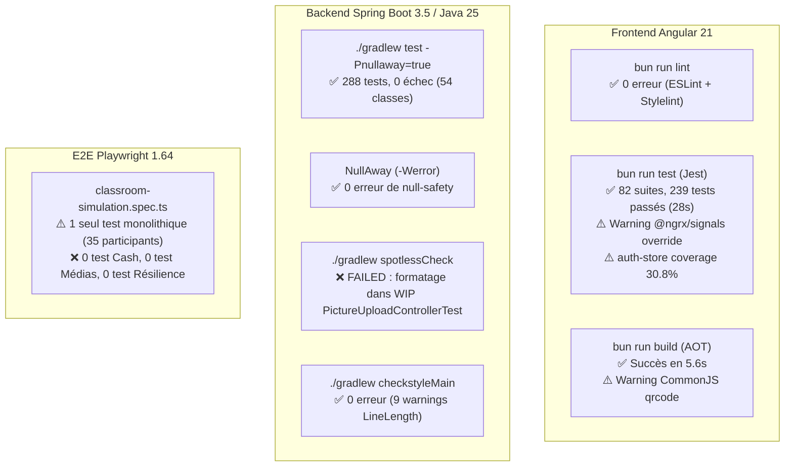
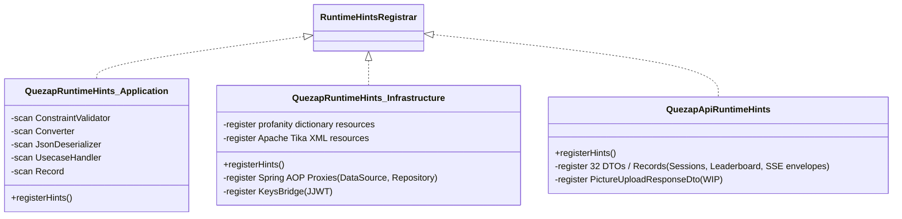
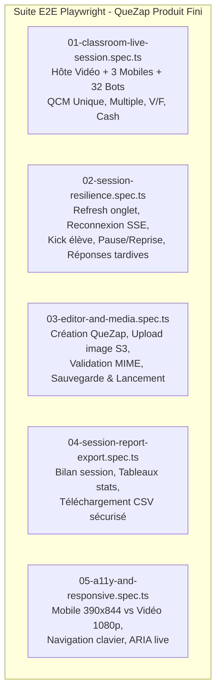

# Spécification Formelle QA, Tests, Build & Environnement Réel — QueZap

**Feature Branch** : `goal/production-ready` (`specs/003-production-readiness/`)  
**Auteur** : `spec-qa-env` (Spécificateur QA, Tests, Build & Environnement Réel — Conseil de Décision)  
**Date** : 18 Novembre 2026  
**Statut** : Prêt pour arbitrage et exécution par lots  

---

## 1. Synthèse de l'Audit Réel de l'Outillage & Environnement Machine

### 1.1 Inventaire Réel des Binaires et Outils Système

L'audit direct des exécutables et sockets de la machine de développement révèle l'environnement réel suivant :

| Composant | Outil & Version Détectée | Localisation Machine | Statut & Remarques Opérationnelles |
| :--- | :--- | :--- | :--- |
| **Runtime JS / Package Manager** | **Bun 1.4.4** | `/home/jeremy/.bun/bin/bun` | Outil principal utilisé pour le frontend (`bun run build`, `bun run test`, `bun run lint`). Exécution ultra-rapide. |
| **Node.js / npm** | **Node v24.18.0 / npm 11.16.0** | `/home/jeremy/.local/bin/node` | Présents sur le système. Utilisés par les scripts Husky et linters. |
| **JDK Standard & GraalVM** | **Oracle GraalVM 25.0.1+8.1** (build 25.0.1+8-LTS-jvmci-b01) | `/home/jeremy/.sdkman/candidates/java/current/bin/java` | `JAVA_HOME` pointe dessus. Java 25 LTS conforme aux exigences du projet. |
| **Compilateur Natif** | **native-image 25.0.1** (Oracle GraalVM 25.0.1+8.1) | `/home/jeremy/.sdkman/candidates/java/current/bin/native-image` | Présent et opérationnel en ligne de commande locale. |
| **Gestionnaire de Conteneurs** | **Podman 4.9.3** | `/usr/bin/podman` | Mode Rootless. Backend réseau : `netavark`. SELinux : `false`. |
| **CLI Docker** | Émulation Podman (`nodocker`) | `/usr/bin/docker` | Wrapper vers Podman. Émet un avertissement d'émulation si `/etc/containers/nodocker` n'existe pas. |
| **Docker Compose** | **docker-compose 1.29.2** (CPython 3.12.3, docker-py 5.0.3) | `/usr/bin/docker-compose` | Version 1 legacy. Nécessite `DOCKER_HOST` explicite pour communiquer avec le socket Podman rootless. |
| **Podman Compose** | **podman-compose 1.0.6** | `/home/jeremy/.local/bin/podman-compose` | Présent sur le système, alternative fonctionnelle native à `docker-compose`. |
| **Socket Conteneurs** | Socket Podman utilisateur | `/run/user/1000/podman/podman.sock` | Actif et appartenant à l'utilisateur `jeremy`. `/var/run/docker.sock` est root-only. |
| **Framework E2E** | **Playwright 1.64.0** | `front/node_modules/.bin/playwright` | Navigateur Chromium installé dans `~/.cache/ms-playwright/chromium-1248`. |
| **Outil de Build Backend** | **Gradle 9.1.0** (Gradle Wrapper) | `./back/gradlew` | Démon Gradle actif en tâche de fond. Supporte Java 25. |

---

### 1.2 État de Santé des Suites de Tests et Contrôles Qualité (Mesures Réelles)

L'audit outillé exécuté sur le codebase (incluant le WIP non commité) donne les métriques suivantes :



#### Points Clés du Diagnostic Qualité :
1. **Frontend (`front/`)** :
   - `bun run lint` est **100% vert** (ESLint TS flat config + Stylelint CSS sans aucun warning).
   - `bun run test` passe **239 tests sur 82 suites** en 28 secondes. Cependant :
     - Présence d'un warning d'initialisation SignalStore dans la console : `@ngrx/signals: SignalStore members cannot be overridden. Trying to override: isSessionPaused, mySubmittedChoice` lors de l'instanciation de `ActiveSessionStore`.
     - Trou de couverture important sur `app/shared/stores/authenticated-user.ts` (**30.8%** de couverture, lignes 38-156 et 160-195 non couvertes).
   - `bun run build` compile sans erreur en mode production en **5.6 secondes**. Il émet un warning de bundle CommonJS : `▲ [WARNING] Module 'qrcode' used by 'node_modules/angularx-qrcode' is not ESM`.
2. **Backend (`back/`)** :
   - `clean test -Pnullaway=true` passe **288 tests unitaires et intégration** sur 54 classes sans aucune régression.
   - **Spotless FAILED** : Le fichier non suivi `back/quezap-api/src/test/java/com/quezap/api/v1/routes/pictures/PictureUploadControllerTest.java` viole le formatage Google Java Format (lignes 120-126). Toute tentative de commit via Husky échouera tant que `./back/gradlew -p back spotlessApply` n'aura pas été exécuté.
   - Checkstyle passe mais remonte 9 lignes trop longues (> 100 caractères) sur des annotations de validation de DTOs.
3. **E2E (`front/tests/e2e/`)** :
   - Un unique fichier `classroom-simulation.spec.ts` existe. Il valide un enchaînement simple (1 hôte + 3 élèves mobiles + 32 bots HTTP sur des questions QCM classiques), mais **ne couvre aucun des parcours avancés exigés pour un niveau production-ready** (Cash, upload d'images, reconnexion SSE, exclusion, réponses tardives, téléchargement de rapports CSV).

---

## 2. Audit Approfondi Conteneurisation & Environnement Local

### ENV-01 : Échec d'Exécution `docker-compose` avec Podman Rootless

- **Sévérité** : Haute (Bloquant pour tout développeur exécutant `docker-compose` standard)
- **Localisation** : Machine hôte / `/usr/bin/docker-compose` / `AGENTS.md:20`
- **Constat** :
  - Sur cette machine (et sur toute installation Linux moderne avec Podman en mode rootless), `docker-compose 1.29.2` cherche par défaut à se connecter au socket root `/var/run/docker.sock`.
  - L'exécution de `docker-compose ps` ou `docker compose up` échoue immédiatement avec l'erreur :
    ```text
    urllib3.exceptions.ProtocolError: ('Connection aborted.', PermissionError(13, 'Permission denied'))
    docker.errors.DockerException: Error while fetching server API version: ('Connection aborted.', PermissionError(13, 'Permission denied'))
    ```
  - Le socket utilisateur réel actif appartient à `jeremy` et réside à `/run/user/1000/podman/podman.sock` (accessible via `$XDG_RUNTIME_DIR/podman/podman.sock`).
  - L'export préalable de `DOCKER_HOST="unix:///run/user/1000/podman/podman.sock"` rend `docker-compose` immédiatement fonctionnel.
  - De plus, la commande `podman-compose` est installée (`/home/jeremy/.local/bin/podman-compose`) et fonctionne sans configuration additionnelle.
- **Correction Requise** :
  1. Documenter formellement dans `AGENTS.md` l'alias ou la variable d'environnement nécessaire sous Podman :
     ```bash
     export DOCKER_HOST="unix://${XDG_RUNTIME_DIR:-/run/user/$(id -u)}/podman/podman.sock"
     # ou utiliser podman-compose
     podman-compose up -d postgres minio minio-init
     ```
  2. Fournir un helper de commande ou script de démarrage unifié pour l'infrastructure locale.

---

### ENV-02 : Bug Critique de Port MinIO en Dev Local & Risque de Collision Hôte

- **Sévérité** : Critique (Bloquant pour le développement de l'upload et affichage d'images en mode local)
- **Localisation** :
  - `docker-compose.yml:32-34`
  - `back/quezap-api/src/main/resources/application.yml:52-58`
  - `AGENTS.md:17-20`
- **Constat** :
  - **Collision détectée sur la machine hôte** : Le port `127.0.0.1:9000-9001` est **déjà utilisé** par un conteneur externe indépendant (`ovoteam-minio`, actif depuis 9 heures).
  - Pour contourner ce conflit historique, le backend Spring Boot a été configuré dans `application.yml` avec le port par défaut `9190` pour l'API S3 et `9191` pour la console :
    ```yaml
    pictures-s3:
      host: ${APP_S3_HOST:localhost}
      port: ${APP_S3_PORT:9190}
      public-endpoint: ${APP_S3_PUBLIC_ENDPOINT:http://localhost:9190}
    ```
  - Et `AGENTS.md` indique textuellement :
    > `MinIO S3 (localhost:9190 API, console 9191, bucket quezap-public-images)`  
    > `Commandes : docker compose up -d postgres minio minio-init`
  - **Cependant, dans `docker-compose.yml`, le service `minio` ne publie AUCUN port sur l'hôte** :
    ```yaml
    minio:
      image: minio/minio:latest
      container_name: quezap-minio
      ...
      expose:
        - "9000"
        - "9001"
      # AUCUN bloc ports: vers l'hôte !
    ```
  - **Conséquence directe** : Lorsqu'un développeur exécute la commande prescrite dans `AGENTS.md` (`docker compose up -d postgres minio minio-init`) pour lancer l'infrastructure puis démarre son backend sur sa machine avec `./gradlew :quezap-api:bootRun`, le backend tente de contacter `localhost:9190` et subit un `Connection refused`. Tout upload ou consultation d'image échoue systématiquement.
- **Correction Requise** :
  Modifier `docker-compose.yml` pour publier explicitement les ports `9190` et `9191` vers l'hôte :
  ```yaml
  minio:
    image: minio/minio:latest
    container_name: quezap-minio
    restart: unless-stopped
    command: server /data --console-address ":9001"
    environment:
      MINIO_ROOT_USER: quezap_java_writer
      MINIO_ROOT_PASSWORD: LocalPassword
    ports:
      - "9190:9000"
      - "9191:9001"
    expose:
      - "9000"
      - "9001"
    volumes:
      - quezap_minio_data:/data
  ```
  De cette façon :
  1. En exécution full conteneurs (`docker compose up`), le réseau interne `quezap-net` utilise `minio:9000` via Nginx (port 8000).
  2. En exécution hybride / dev local (`bootRun` + `ng serve`), le backend Spring Boot accède à MinIO via `http://localhost:9190` sans entrer en collision avec le port 9000 de la machine.

---

### ENV-03 : Anomalie de Détection de Port dans `seed.sh` en Profil Conteneurisé

- **Sévérité** : Moyenne
- **Localisation** : `seed.sh:133-137` et `docker-compose.yml:147-150`
- **Constat** :
  - Dans `docker-compose.yml`, le service `seed` injecte la variable `FRONT_PORT: "8000"`.
  - Or, dans `seed.sh`, les lignes 133-136 écrasent inconditionnellement cette valeur :
    ```bash
    FRONT_PORT="4200"
    if curl -s -m 1 "http://localhost:8000" > /dev/null 2>&1; then
      FRONT_PORT="8000"
    fi
    ```
  - Dans le conteneur `quezap-seed`, `http://localhost:8000` échoue car le service `frontend` est sur le réseau Docker `quezap-net` (`http://frontend:80`) et non sur le `localhost` du conteneur `seed`.
  - Le script affiche donc un lien erroné en port 4200 au lieu de 8000.
- **Correction Requise** :
  Initialiser `FRONT_PORT` avec la valeur d'environnement : `FRONT_PORT="${FRONT_PORT:-4200}"` et tester la connectivité seulement si non définie.

---

### ENV-04 : Compatibilité Docker Compose v1 (`condition: service_completed_successfully`)

- **Sévérité** : Moyenne
- **Localisation** : `docker-compose.yml:73-74,118-119`
- **Constat** :
  - `docker-compose.yml` utilise la condition avancée :
    ```yaml
    depends_on:
      postgres:
        condition: service_healthy
      minio-init:
        condition: service_completed_successfully
    ```
  - Cette directive est nativement reconnue par la spécification Compose v2 et par `docker-compose config` 1.29.2.
  - Cependant, sous `podman-compose 1.0.6`, le cycle de vie des conteneurs éphémères (qui effectuent une tâche puis quittent avec exit 0 comme `minio-init`) peut bloquer le démarrage de `backend` si le moteur attend un conteneur en état continu.
- **Critère de Vérification** :
  Le dry-run `docker-compose up --no-start --no-build` valide la syntaxe sans erreur. Lors de l'exécution complète, `minio-init` doit impérativement s'exécuter rapidement (création du bucket `quezap-public-images` et politique anonyme de lecture) avant que le backend ne démarre.

---

### ENV-05 : Configuration Nginx (`front/nginx.conf`) & Support SSE / S3

- **Sévérité** : Basse (Audit de conformité)
- **Localisation** : `front/nginx.conf`
- **Constat** :
  - La configuration Nginx actuelle est de très haute qualité :
    - `gzip` complet sur JS/CSS/WASM/JSON.
    - Headers de sécurité `X-Content-Type-Options: nosniff`, `X-Frame-Options: SAMEORIGIN`.
    - PWA & Service Worker (`ngsw.json`) configurés en `no-cache`.
    - Assets hashés mis en cache immuable 1 an (`Cache-Control: public, max-age=31536000, immutable`).
    - **Support SSE parfait** : `proxy_buffering off`, `chunked_transfer_encoding on`, timeouts à 86400s sur `/apiv1/`.
    - **Proxy S3 intégré** : `location ^~ /quezap-public-images/` redirige vers `http://minio:9000/quezap-public-images/` avec le bon header `Host`.
  - Aucun ajustement majeur n'est requis sur `front/nginx.conf`, si ce n'est de s'assurer que le montage de volume dans `docker-compose.yml` (`./front/nginx.conf:/etc/nginx/conf.d/default.conf:ro`) fonctionne sans problème de droits en environnement Podman rootless (droit de lecture accordé au conteneur Nginx Alpine).

---

## 3. Audit de la Chaîne GraalVM 25 Native Image

### NATIVE-01 : Configuration Gradle & Plugin GraalVM

- **Localisation** : `back/build.gradle:5,192,219-237,247,272-282` et `gradle/libs.versions.toml:6,33`
- **Constat** :
  - Le plugin utilisé est `org.graalvm.buildtools.native` version **0.10.6**, parfaitement compatible avec Spring Boot 3.5.7 et Java 25.
  - Deux cibles binaires natives sont définies :
    - `:quezap-api:nativeCompile` (binaire `quezap-api`)
    - `:quezap-cli:nativeCompile` (binaire `quezap-cli`)
  - Options de compilation native spécifiées :
    - `-H:+ReportExceptionStackTraces`
    - `--no-fallback` (interdit tout fallback JVM silencieux en cas d'erreur AOT)
    - `-march=compatibility` (assure la portabilité x86-64 sans crash sur CPU hôte différent)
  - Agent de traçage AOT configuré en mode conditionnel via `user-code-filter.json` (filtrage ciblé sur `com.quezap.**`).

---

### NATIVE-02 : Analyse des Enregistrements AOT Runtime Hints

Le projet dispose de trois classes d'enregistrement AOT implémentant `RuntimeHintsRegistrar` :



#### Trous et Risques Détectés pour la Compilation Native :
1. **Entités JPA & Repositories dynamiques** :
   - `QuezapRuntimeHints_Infrastructure` enregistre les proxys dynamiques JDK pour `DataSource` et `Repository` avec `SpringProxy`, `Advised`, `Factory`, `DecoratingProxy`. C'est conforme aux exigences de Spring Data JPA.
   - **Risque WIP** : Le nouveau repository `StagedPictureJpaRepository` et l'entité `StagedPictureJpaEntity` doivent être visibles par le classloader AOT lors du build natif.
2. **Apache Tika & Multipart Upload** :
   - Dans `QuezapRuntimeHints_Infrastructure:62-64`, les fichiers XML `tika-mimetypes.xml` et `tika-external-parsers.xml` sont bien enregistrés dans les ressources natives.
   - Cependant, la détection dynamique de type MIME par Tika instancie des parsers par réflexion (`ServiceLoader`). Si des types exotiques sont uploadés, un avertissement ou une exception de parsing AOT peut survenir. La validation stricte par magic bytes (PNG, JPEG, WebP) proposée par `spec-architect` élimine ce risque en évitant l'instanciation de parsers complexes.
3. **Absence de Test Automatisé `nativeTest` en CI locale** :
   - La compilation native (`nativeCompile`) requiert 4 à 8 minutes et ~8 Go de RAM. Elle ne doit pas être exécutée sur chaque commit local.
   - En revanche, la tâche Gradle de préparation AOT `:quezap-api:processAot` et `:quezap-api:compileAotTestJava` est ultra-rapide (quelques secondes) et doit être exécutée en vérification de non-régression des hints.

---

### NATIVE-03 : Décalage Entre `back/Dockerfile` et l'Exécution Native

- **Localisation** : `back/Dockerfile`
- **Constat** :
  - `back/Dockerfile` est un build standard Temurin 25 JDK produisant et exécutant un jar JVM (`./gradlew :quezap-api:bootJar`).
  - Il ne compile **pas** de binaire GraalVM natif.
  - Ce choix est pertinent pour le temps de build du conteneur en développement (30 secondes contre plusieurs minutes en natif).
  - Pour une distribution "production native", un Dockerfile dédié (`back/Dockerfile.native`) utilisant l'image de compilation GraalVM ou le binaire compilé sur l'hôte doit être prévu comme livrable d'infrastructure.

---

## 4. Cartographie Complète de la Suite E2E Playwright "Produit Fini"

### 4.1 Diagnostic de la Suite E2E Existante

Le fichier actuel `front/tests/e2e/classroom-simulation.spec.ts` (151 lignes) est une bonne preuve de concept, mais présente plusieurs limites structurelles :
- **Monolithique** : Tout est dans un seul test de 90 secondes. Si une étape échoue (ex. clic sur classement), l'ensemble du test s'arrête sans diagnostiquer le reste.
- **Périmètre question restreint** : Ne teste que 2 affirmations et 1 QCM.
- **Absence totale des questions Cash** : Aucun test de saisie texte, d'autocomplétion, de casse ou de tolérance orthographique.
- **Absence des médias** : Aucune question avec image n'est testée.
- **Absence de test de résilience** : Aucun refresh de page, aucune déconnexion réseau simulée, aucune exclusion d'élève.
- **Absence des parcours de gestion** : L'éditeur de QueZap, l'upload d'image, et le téléchargement de rapport post-session ne sont pas testés de bout en bout dans le navigateur.

---

### 4.2 Matrice des 5 Nouvelles Suites E2E Playwright

Pour atteindre un niveau de qualité "produit fini", la suite E2E doit être découpée en **5 spécifications modulaires et indépendantes** dans `front/tests/e2e/` :



---

### 4.3 Spécification Détaillée des 5 Suites E2E

#### E2E-01 : Simulation de Session de Classe Complète Multi-Types de Questions
- **Fichier** : `front/tests/e2e/01-classroom-live-session.spec.ts`
- **Acteurs & Contextes** :
  - Contexte Hôte : Desktop Chrome 1920x1080 (écran vidéoprojecteur).
  - Contextes Élèves : 3 contextes mobiles émulés (iPhone 14, 390x844, tactile activé).
  - Contexte Simulateur : 32 bots HTTP soumettant des requêtes via l'API REST.
- **Parcours à Valider** :
  1. **Lobby & Inscription** :
     - L'hôte se connecte, crée une session pour un QueZap complet et arrive sur `/admin/sessions/{id}/present`.
     - Les 3 élèves rejoignent via `/quizz/join/{PIN}` avec leurs pseudonymes ("Léa", "Maximilien", "Zoé").
     - 32 bots rejoignent en HTTP via `/sessions/join`.
     - L'écran hôte affiche en temps réel le compteur synchronisé : **35 participants**.
  2. **Question 1 — Affirmation (Vrai / Faux)** :
     - L'hôte démarre. Le timer se lance synchronisé sur l'hôte et les mobiles.
     - Les élèves cliquent sur "VRAI" ou "FAUX".
     - Feedback visuel immédiat : bouton sélectionné, état d'attente "Réponse enregistrée".
     - L'hôte révèle : affichage du camembert/barre de distribution et de la bonne réponse.
  3. **Question 2 — QCM à Choix Unique (4 choix)** :
     - Les élèves reçoivent les 4 tuiles colorées.
     - Validation de la sélection unique (changer d'avis avant validation si autorisé, ou clic direct).
  4. **Question 3 — QCM à Choix Multiples (4 choix, 2 réponses attendues)** :
     - L'élève doit pouvoir cocher 2 tuiles puis cliquer sur "Valider ma réponse".
     - Les tuiles restent sélectionnées visuellement jusqu'à confirmation.
  5. **Question 4 — Question Cash (Saisie Libre)** :
     - L'élève reçoit un champ de saisie texte avec bouton de soumission ("Envoyer").
     - L'élève 1 saisit la réponse exacte avec majuscule et accent ("Mercure") -> validée correcte.
     - L'élève 2 saisit la réponse sans accent et en minuscules ("mercure") -> normalisation acceptée par le backend.
     - L'élève 3 saisit une réponse fausse ("Jupiter") -> enregistrée comme incorrecte.
  6. **Podium Final** :
     - Classement intermédiaire après chaque question.
     - Fin du quiz : affichage du podium animé (1ère, 2ème, 3ème place) avec scores et confettis.

---

#### E2E-02 : Résilience de Session, Déconnexions & Edge Cases
- **Fichier** : `front/tests/e2e/02-session-resilience.spec.ts`
- **Parcours & Edge Cases à Valider** :
  1. **Reconnexion après Refresh d'Onglet (F5 Élève)** :
     - Pendant le compte à rebours d'une question, l'élève 1 rafraîchit sa page (`page.reload()`).
     - Le `sessionStorage` conserve le token de participation.
     - L'application restaure automatiquement la session en cours sans réclamer le code PIN.
     - L'état de réponse déjà envoyée reste préservé, le décompte temps est exact, l'élève ne peut pas revoter deux fois.
  2. **Coupure et Reprise du Flux SSE** :
     - Simulation d'une interruption temporaire du flux SSE (fermeture de la connexion côté réseau).
     - Le client `EventSource` / Service SSE frontend reconnecte automatiquement en envoyant `Last-Event-ID`.
     - Aucun écran d'erreur bloquant n'apparaît.
  3. **Gestion des Réponses Tardives (Late Answers)** :
     - Un bot tente d'envoyer une réponse après que le timer soit tombé à 0 ou après le clic "Révéler" de l'hôte.
     - Le backend retourne un code HTTP `409 Conflict` ou `400 Bad Request`.
     - L'interface élève affiche le message d'état : "Temps écoulé, réponse non prise en compte".
  4. **Exclusion d'un Élève par l'Hôte (Kick)** :
     - Sur l'écran présentateur, l'hôte survole un élève indésirable dans la liste et clique sur "Exclure".
     - L'événement SSE `PARTICIPANT_KICKED` est émis par le backend.
     - L'onglet de l'élève exclu est immédiatement redirigé vers `/quizz/ended` avec le message "Vous avez été exclu de la session".
     - Les tentatives de requêtes ultérieures de ce participant sont rejetées (`401` ou `403`).
     - Le compteur de l'hôte décrémente instantanément le participant.
  5. **Départ Volontaire d'un Élève (Leave)** :
     - L'élève clique sur "Quitter le quiz" et confirme la modale.
     - Redirection vers l'accueil.
     - L'hôte reçoit la notification de départ ou la décrémentation dans l'état de la session.
  6. **Pause et Reprise par l'Hôte** :
     - L'hôte clique sur "Mettre en pause".
     - L'événement `SESSION_PAUSED` fige le compte à rebours sur l'écran hôte et sur tous les mobiles élèves. Les zones de saisie et tuiles de réponse sont désactivées.
     - L'hôte clique sur "Reprendre" : le compte à rebours reprend exactement là où il s'était arrêté.

---

#### E2E-03 : Éditeur de QueZap & Gestion des Images Médias (S3)
- **Fichier** : `front/tests/e2e/03-editor-and-media.spec.ts`
- **Parcours à Valider** :
  1. **Création d'un QueZap dans l'Éditeur** :
     - L'enseignant se connecte à l'administration et accède à `/admin/quezaps/create`.
     - Saisie du titre, description, sélection du thème, activation de la visibilité publique.
  2. **Ajout de Questions avec Médias** :
     - Ajout d'une question QCM avec texte, timer (20s), points (1000).
     - Upload d'une image d'illustration :
       - Simulation de sélection de fichier image valide (`test-picture.png`, 150 Ko).
       - Vérification de l'appel REST `POST /apiv1/pictures/upload` retournant l'URL stagée S3.
       - Affichage immédiat de la prévisualisation dans la tuile de question.
  3. **Validation et Rejet de Fichiers Invalides** :
     - Tentative d'upload d'un fichier trop volumineux (> 5 Mo) ou d'un format interdit (ex. `.exe` ou faux PNG textuel).
     - Affichage d'un toast/message d'erreur utilisateur explicite.
     - L'état de l'éditeur n'est pas corrompu.
  4. **Sauvegarde et Vérification en BDD** :
     - Sauvegarde finale du QueZap (`POST /apiv1/quezaps`).
     - Redirection vers la liste `/admin/quezaps`. Le nouveau quiz apparaît avec son badge de questions et son visuel.
  5. **Rendu de l'Image en Session Réelle** :
     - Lancement direct de la session depuis la liste.
     - Arrivée sur la question avec image : l'image s'affiche en grand sur l'écran projecteur hôte (`1920x1080`), et en miniature cliquable/agrandissable sur le viewport élève mobile (`390x844`).

---

#### E2E-04 : Bilan Post-Session, Exports CSV & Reporting Enseignant
- **Fichier** : `front/tests/e2e/04-session-report-export.spec.ts`
- **Parcours à Valider** :
  1. **Clôture de Session et Navigation vers le Rapport** :
     - À la fin d'une session jouée par plusieurs élèves, l'hôte clique sur "Terminer la session".
     - Navigation vers `/admin/sessions/{id}/report`.
  2. **Vérification de l'Affichage Analytique** :
     - Le composant `SessionReport` affiche :
       - Le taux de réussite global de la classe (badge PrimeNG `success` si >= 70%, `warn` si >= 40%, `danger` sinon).
       - Le tableau récapitulatif par question : taux d'exactitude, nombre de participants ayant répondu, temps moyen.
       - Le tableau complet des participants : rang, nom, score total, détail des bonnes réponses.
  3. **Téléchargement Sécurisé du Fichier CSV** :
     - L'hôte clique sur le bouton "Exporter en CSV".
     - Playwright intercepte l'événement de téléchargement du navigateur (`page.waitForEvent('download')`).
     - Validation des critères du fichier téléchargé :
       - Nom de fichier conforme : `session-{numéro}-resultats.csv`.
       - Content-Type : `text/csv`.
       - Présence des en-têtes CSV attendus : `Rang,Participant,Score,Bonnes Reponses,Temps Total`.
       - Protection contre l'injection de formules CSV : aucune formule non échappée commençant par `=`, `+`, `-`, `@` dans les pseudonymes élèves.

---

#### E2E-05 : Accessibilité, Responsive & Navigation Clavier
- **Fichier** : `front/tests/e2e/05-a11y-and-responsive.spec.ts`
- **Parcours à Valider** :
  1. **Responsive Viewport Mobile (390x844)** :
     - Vérification de l'absence totale de défilement horizontal (`document.documentElement.scrollWidth <= window.innerWidth`).
     - Zones tactiles (hitboxes) de tous les boutons de réponse conformes aux standards ergonomiques (hauteur minimale >= 44px).
  2. **Navigation Intégrale au Clavier** :
     - L'élève doit pouvoir rejoindre une session, saisir son pseudo, valider via `Enter`, naviguer entre les choix avec `Tab` et sélectionner une réponse avec `Space` ou `Enter`.
     - Dans la question Cash, la touche `Enter` soumet directement la saisie textuelle sans nécessiter le clic souris.
  3. **Attributs ARIA & Lecteurs d'Écran** :
     - Présence de `aria-live="polite"` pour l'annonce du temps restant critique et la révélation des résultats.
     - Attributs `aria-label` sur tous les boutons contenant uniquement une icône (bouton fermer, bouton plein écran, bouton quitter).

---

## 5. Matrice de Testabilité, Couverture de Code & Stratégie CI/CD

### 5.1 Objectifs de Couverture Cibles par Couche

| Couche Logique | Module du Projet | Outil de Mesure | Couverture Actuelle | Cible Minimale "Production-Ready" | Points d'Attention Spécifiques |
| :--- | :--- | :--- | :--- | :--- | :--- |
| **Domaine Métier** | `:modules:domain` | JaCoCo | ~90% | **95%** | Zéro framework. Invariants `Domain.checkDomain`, règles de calcul de score, égalité des Value Objects. |
| **Cas d'Usage** | `:modules:application` | JaCoCo | ~65% | **85%** | Handlers applicatifs `@Usecase`, coordination des transactions et événements du domaine. |
| **Adaptateurs JPA / S3** | `:modules:infrastructure` | JaCoCo | ~75% | **85%** | Mappings Entités JPA <-> Modèles Domaine, intégrité des hashes Argon2/SHA-256, gestion S3. |
| **Contrôleurs REST** | `quezap-api` | JaCoCo / MockMvc | ~70% | **85%** | Sérialisation HTTP, codes retours, gestion des erreurs dans `GlobalExceptionHandler`. |
| **Signal Stores Frontend** | `front/src/app/**/stores` | Jest | ~70% | **90%** | Combler le gap de `authenticated-user.ts` (30.8% -> 90%) et `ActiveSessionStore`. |
| **Composants Angular** | `front/src/app/**/components` | Jest | ~80% | **85%** | Gestion des inputs Signals, affichage conditionnel, formulaires Zod. |
| **Parcours Bout-en-Bout** | `front/tests/e2e/` | Playwright | 1 scénario partiel | **5 suites complètes** | Validation multi-navigateurs et multi-clients concurrents. |

---

### 5.2 Boucle Rapide Développeur vs Pipeline Qualité Global

Pour concilier rapidité de développement et rigueur absolue :

```mermaid
flowchart LR
    subgraph DevLoop [Boucle Locale Développeur (Secondes)]
        T1["Test ciblé module/classe<br/>(ex. :modules:domain:test)"]
        T2["Jest ciblé composant/store<br/>(bun run test -- mon-fichier.spec.ts)"]
        T3["Formatage automatique<br/>(gradle spotlessApply / bun run lint:fix)"]
    end

    subgraph PreCommit [Pre-Commit / Pre-Push (Husky)]
        P1["Spotless Check + Checkstyle"]
        P2["ESLint + Stylelint"]
        P3["Vérification Scopes Commitlint"]
    end

    subgraph CI_Gate [Quality Gate CI (Build / Docker)]
        C1["./gradlew test -Pnullaway=true (-Werror)"]
        C2["bun run lint && bun run test && bun run build"]
        C3["Playwright E2E Matrix (5 suites)"]
        C4["Génération & Vérification AOT Native"]
    end

    DevLoop --> PreCommit --> CI_Gate
```

---

## 6. Pièges Environnement, Build & Tooling à Documenter dans AGENTS.md

Cette section regroupe l'ensemble des pièges concrets rencontrés sur l'environnement de build et d'exécution, prêts à être intégrés dans `AGENTS.md` :

### 6.1 Piège Podman Rootless & `docker-compose` 1.29.2
- **Symptôme** : `PermissionError: [Errno 13] Permission denied: '/var/run/docker.sock'` lors de l'exécution de `docker-compose` ou `docker compose`.
- **Cause** : Podman rootless n'a pas accès au socket système root `/var/run/docker.sock`. Le socket utilisateur actif est situé dans le répertoire runtime de l'utilisateur (`/run/user/$(id -u)/podman/podman.sock`).
- **Solution permanente** :
  ```bash
  # Exporter le socket utilisateur pour docker-compose
  export DOCKER_HOST="unix://${XDG_RUNTIME_DIR:-/run/user/$(id -u)}/podman/podman.sock"
  # Ou utiliser directement l'outil natif podman-compose
  podman-compose up -d postgres minio minio-init
  ```

---

### 6.2 Piège MinIO : Conflit de Port Hôte 9000/9001 et Décalage 9190/9191
- **Symptôme** : En mode dev local, le backend démarre et échoue avec `ConnectException: Connection refused` sur `localhost:9190` lors de tout accès S3.
- **Cause** :
  - Sur de nombreuses machines de dev, le port `9000` est déjà utilisé par d'autres conteneurs MinIO ou services locaux.
  - Le fichier `application.yml` écoute par défaut sur le port décalé `9190` (`pictures-s3.port: 9190`).
  - `docker-compose.yml` n'exposait le port MinIO qu'en interne sans publier les ports `9190:9000` et `9191:9001` sur l'hôte.
- **Règle** : Toujours vérifier que `docker-compose.yml` publie :
  ```yaml
  ports:
    - "9190:9000"
    - "9191:9001"
  ```
  Et que le backend local pointe sur `APP_S3_HOST=localhost` et `APP_S3_PORT=9190`.

---

### 6.3 Piège Spotless & Hook Pre-Commit Java
- **Symptôme** : `git commit` échoue avec le message `Execution failed for task ':spotlessJavaCheck'`.
- **Cause** : Google Java Format est strictement vérifié par le hook `.husky/pre-commit` via `.lintstagedrc.json`. Tout saut de ligne ou indentation non conforme dans un fichier `.java` stagé bloque le commit.
- **Solution immédiate** :
  ```bash
  ./back/gradlew -p back spotlessApply
  ```

---

### 6.4 Piège NullAway : Flag Obligatoire `-Pnullaway=true`
- **Symptôme** : Les tests passent localement, mais la CI échoue avec `-Werror` sur une déréférence potentiellement nulle.
- **Cause** : Par défaut dans `back/build.gradle:84`, NullAway est en mode `CheckSeverity.OFF` pour ne pas ralentir la compilation incrémentale standard. Il n'est activé en mode `ERROR` avec `-Werror` que si la propriété Gradle `-Pnullaway=true` est explicitement passée.
- **Règle absolue** : Toujours exécuter la commande de validation complète avant de conclure une tâche backend :
  ```bash
  ./back/gradlew -p back clean test -Pnullaway=true
  ```

---

### 6.5 Piège Frontend : Avertissement CommonJS `qrcode` dans Angular 21
- **Symptôme** : `▲ [WARNING] Module 'qrcode' used by 'node_modules/angularx-qrcode' is not ESM` lors de `bun run build`.
- **Cause** : La bibliothèque `angularx-qrcode` s'appuie sur le module CommonJS `qrcode`, provoquant un avertissement d'optimisation du bundler esbuild d'Angular.
- **Solution** : Ajouter `"allowedCommonJsDependencies": ["qrcode"]` dans `front/angular.json` sous `architect.build.options`.

---

### 6.6 Piège NgRx SignalStore : Membres Déjà Définis
- **Symptôme** : `console.warn: @ngrx/signals: SignalStore members cannot be overridden. Trying to override: isSessionPaused, mySubmittedChoice`.
- **Cause** : Dans `ActiveSessionStore`, des propriétés d'état ou des méthodes sont déclarées à la fois dans `withState(...)` et dans un feature mixin ou une extension calculée `withComputed(...)`.
- **Règle** : Chaque membre d'un SignalStore doit avoir un nom unique à travers tous les blocs `withState`, `withComputed` et `withMethods`.

---

### 6.7 Piège Playwright E2E : URL Cible & Lancement des Serveurs
- **Symptôme** : Playwright échoue avec `net::ERR_CONNECTION_REFUSED http://localhost:8000`.
- **Cause** : Playwright pointe par défaut sur `http://localhost:8000` (l'application complète Nginx sous Docker).
- **Règle** :
  - Pour exécuter les E2E sur l'environnement conteneurisé : s'assurer que `DOCKER_HOST="unix:///run/user/1000/podman/podman.sock" docker-compose up -d` est démarré et que `seed.sh` a été joué.
  - Pour exécuter les E2E sur l'environnement de dev local : lancer `bun run start` (port 4200) et passer `PLAYWRIGHT_BASE_URL="http://localhost:4200" bun run test:e2e`.

---

## 7. Plan de Découpage en Lots d'Exécution (Sans Collision)

Pour permettre une exécution fluide par les agents implémenteurs sans aucun conflit de fichiers avec les chantiers backend (`spec-backend-arch.md`) et frontend (`spec-product-ux.md`), le plan QA & Environnement est structuré en **4 lots séquentiels et indépendants** :

```mermaid
gantt
    title Plan d'Exécution QA & Environnement
    dateFormat X
    axisFormat %s

    section Lot 1 : Socle Env & Tooling
    Corriger docker-compose.yml ports MinIO & seed.sh : active, 0, 1
    Mettre à jour AGENTS.md avec les pièges Podman/MinIO : 1, 2

    section Lot 2 : Couverture & Warnings Frontend
    allowedCommonJsDependencies dans angular.json : 2, 3
    Corriger override warning SignalStore : 3, 4
    Tests unitaires authenticated-user.ts (couverture 90%) : 4, 5

    section Lot 3 : Suite E2E Playwright Avancée
    E2E-01 Live session multi-questions (Cash, QCM, V/F) : 5, 6
    E2E-02 Résilience, F5, Kick, Pause, SSE : 6, 7
    E2E-03 Éditeur QueZap & Upload image S3 : 7, 8
    E2E-04 Rapport de session & Export CSV : 8, 9
    E2E-05 Responsive mobile & A11y clavier : 9, 10

    section Lot 4 : Vérification Native & CI Gate
    Validation compilation AOT processAot : 10, 11
    Audit de non-régression Spotless/NullAway/Checkstyle : 11, 12
```



---

### Lot 1 — Correction de l'Environnement Docker / Podman & Documentation `AGENTS.md`
- **Fichiers concernés** :
  - `docker-compose.yml`
  - `seed.sh`
  - `AGENTS.md`
- **Tâches à réaliser** :
  1. Ajouter les ports `9190:9000` et `9191:9001` sous le service `minio` dans `docker-compose.yml`.
  2. Ajuster `seed.sh` pour respecter la variable `$FRONT_PORT` injectée par Docker Compose.
  3. Enrichir `AGENTS.md` avec la section documentant l'export `DOCKER_HOST` pour Podman rootless, le mapping de ports MinIO, et les commandes de formatage Spotless.
- **Critères d'Acceptation** :
  - `docker-compose config` ou `podman-compose config` s'exécute avec succès.
  - MinIO est accessible sur `http://localhost:9190` en dev local sans entrer en collision avec le port hôte 9000.

---

### Lot 2 — Résolution des Warnings & Couverture de Tests Frontend
- **Fichiers concernés** :
  - `front/angular.json`
  - `front/src/app/features/quizz/stores/active-session.ts`
  - `front/src/app/shared/stores/authenticated-user.spec.ts`
- **Tâches à réaliser** :
  1. Ajouter `"allowedCommonJsDependencies": ["qrcode"]` dans `angular.json` pour supprimer le warning esbuild.
  2. Résoudre le conflit de noms (`isSessionPaused`, `mySubmittedChoice`) dans `ActiveSessionStore` pour éliminer le `console.warn` @ngrx/signals lors des tests.
  3. Compléter les tests unitaires de `authenticated-user.ts` pour faire passer la couverture de code de 30.8% à >= 85%.
- **Critères d'Acceptation** :
  - `cd front && bun run build` compile sans aucun warning de dépendance CommonJS.
  - `cd front && bun run test` passe tous les tests sans émettre de warning @ngrx/signals.
  - La couverture de `authenticated-user.ts` dépasse 85%.

---

### Lot 3 — Implémentation des 5 Suites E2E Playwright de Niveau Produit Fini
- **Fichiers concernés** :
  - `front/playwright.config.ts`
  - `front/tests/e2e/01-classroom-live-session.spec.ts`
  - `front/tests/e2e/02-session-resilience.spec.ts`
  - `front/tests/e2e/03-editor-and-media.spec.ts`
  - `front/tests/e2e/04-session-report-export.spec.ts`
  - `front/tests/e2e/05-a11y-and-responsive.spec.ts`
- **Tâches à réaliser** :
  1. Configurer `playwright.config.ts` pour supporter l'exécution modulaire et la parallélisation contrôlée.
  2. Écrire la suite `01-classroom-live-session.spec.ts` avec les questions QCM unique, multiple, Vrai/Faux et Cash.
  3. Écrire la suite `02-session-resilience.spec.ts` (refresh F5, reconnexion SSE, exclusion d'élève, pause/reprise, réponses tardives).
  4. Écrire la suite `03-editor-and-media.spec.ts` (création de quiz, upload d'image, validation S3, affichage hôte/élève).
  5. Écrire la suite `04-session-report-export.spec.ts` (bilan session, vérification download CSV, protection injection formules).
  6. Écrire la suite `05-a11y-and-responsive.spec.ts` (viewport mobile 390x844, navigation clavier, attributs ARIA).
- **Critères d'Acceptation** :
  - Chaque fichier de test est autonome et indépendant.
  - L'ensemble des 5 suites s'exécute et passe en mode headless avec Playwright (`bun run test:e2e`).

---

### Lot 4 — Validation de l'AOT GraalVM, Spotless & Quality Gate Finale
- **Fichiers concernés** :
  - `back/quezap-api/src/test/java/com/quezap/api/v1/routes/pictures/PictureUploadControllerTest.java`
  - Configuration Gradle / CI
- **Tâches à réaliser** :
  1. Appliquer `spotlessApply` sur le backend pour résoudre la violation de formatage sur `PictureUploadControllerTest.java`.
  2. Valider la compilation AOT Spring Boot native via `./back/gradlew -p back :quezap-api:processAot :quezap-api:compileAotTestJava`.
  3. Lancer la chaîne de validation qualité complète backend & frontend :
     - `./back/gradlew -p back clean test -Pnullaway=true`
     - `./back/gradlew -p back checkstyleMain checkstyleTest spotlessCheck`
     - `cd front && bun run lint && bun run test && bun run build`
- **Critères d'Acceptation** :
  - Spotless et Checkstyle passent à 100% avec zéro échec.
  - NullAway passe avec zéro warning/erreur sous `-Werror`.
  - Le frontend compile et teste avec zéro erreur.
